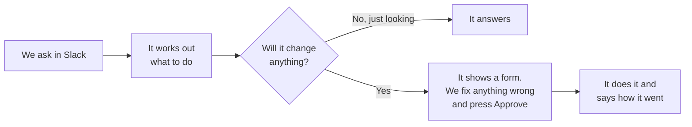
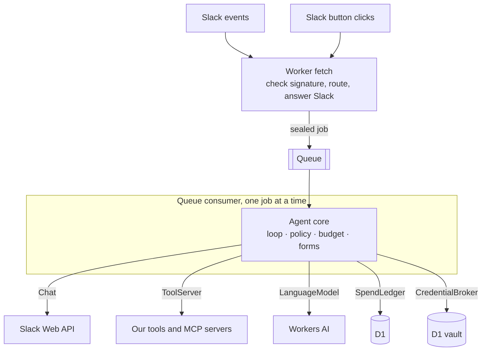
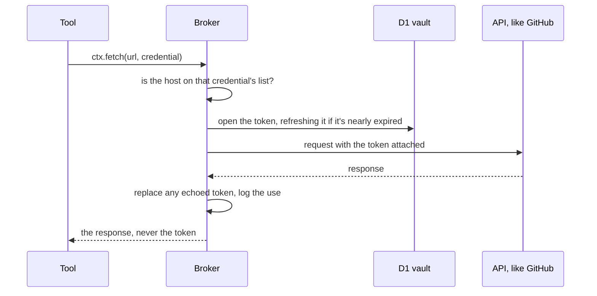

::: plain
## The short version

We wanted to know if an AI assistant could skip the app entirely. Most AI tools want another login, another tab, another place a team forgets to check. Our team already has Slack open all day, so we built an assistant that only exists there.

We message it like we'd message a colleague. When it wants to do something, it shows us exactly what it's about to do and waits for someone to press Approve. There's no website to log into and no dashboard. Even its settings turned out to fit in a Slack form.



## What we tried

**Making it ask before it changes anything.** Looking something up just happens. Anything that sends, books, edits or deletes shows a form first, with Approve and Deny buttons.

**Letting us fix its work before approving.** We started with a plain yes or no, and an editable form turned out to be much better. If it's got the wrong date or the wrong customer, we change it in the form and approve. No starting again.

**Asking when something's missing.** When we asked "how many days until the job?" without saying which date, it gave us a date picker instead of guessing.

**Photos and links.** We can attach a photo, like a receipt or a job site, and ask about it. The main AI never looks at the picture. When we ask, a second, cheaper AI looks at it once and describes it, text and all, and the main one answers from that description. It costs less than a twentieth of a US cent a photo. Tools can send pictures back too, and links come out as links you can click.

**A hard limit on spending.** Every AI request is logged with what it cost. At 90% of the monthly limit, it stops taking on new work and says so.

**Keeping conversations private.** We only used AI services that don't keep what's sent to them or train on it.

## What it cost us

Cloudflare's paid plan is $5 a month (USD), which covers the hosting. The AI is on top, and we capped it at another $5 a month. At a few dozen questions a day on the standard models, we haven't come close.

## Keeping logins safe

An assistant is only useful if it can get into other systems, like accounting or job software. That means it needs logins, and that was the part we worried about most.

We set it up so the assistant never sees them. When an account is connected, its key is locked away separately for each business. When the assistant needs it, a separate part of the system opens it, uses it and hands back only the answer. The AI, Slack and the tools never see the key, so even a cleverly worded message can't trick it into giving one out.

## What went wrong

**It checked the time every time someone said hi.** One of the AI models we tried would look up the time on "Hey", then keep looking it up after it already had the answer. We had to tell it, in plain words, to only use a tool when the message asks for what that tool does.

**Slack only waits three seconds.** If Slack doesn't get an answer within three seconds, it sends the message again, and the assistant would have started the same job twice. Now it says "got it" straight away and does the work afterwards.

**The settings didn't fit in one message.** Slack limits how much one message can hold, and the settings form used half of it before any tools were listed. Now the tool settings go over more than one page when there are a lot of them.

**It cut its own answers short.** When we moved to a newer, cheaper AI model and asked what it could do, it said "I have access to the following tools:" and stopped there, every time. The setting that holds it to a strict answer format was ending the answer at the first new line. We loosened that setting and check the answer ourselves once it arrives.

**The new model overthought everything.** By default it reasoned through every message step by step before answering. That took six seconds and about six times the cost, for the same answer. With that turned off, it answers in about a second.

**Anyone could press the Connect button.** In a shared channel, whoever clicked the button first connected their own account, not the account of the person who asked. Now only the person who asked can see the button, and the assistant still says whose account it connected.

## Where we think it fits

It suits a team that already lives in Slack and has a few jobs it would hand off, but not without checking them first.

The same idea would work in Microsoft Teams, but we've only built it for Slack.

It's not a receptionist. We built it for our own team, not for answering customers.

## If you want to try it

The question we'd ask a developer first:

> If we gave an AI assistant access to our systems, what stops it doing something we didn't approve, and who can see our passwords?

The technical version of this lab has the design, the code and the mistakes.
:::

::: technical
## Why we tried it

Agent products usually ship three things: a chat window, a settings dashboard and an approvals screen. That's a web app with auth, sessions and its own UI to maintain, and it's one more place nobody checks. Slack already has identity, notifications, threads and a form system (Block Kit). If every tool's inputs and outputs can be drawn as Block Kit, the agent doesn't need any other interface.

## Hypothesis

Make the Slack UI part of the tool contract. If each tool must declare its inputs as Slack form elements and its outputs as Slack blocks, then approvals, missing inputs, follow-up questions and results can all be generated from that one declaration, and the agent never needs a web app.

## Components

- One Cloudflare Worker per Slack workspace, the way we run one Worker per client. It has its own D1 database, KV namespace, queue and secrets, so there are no tenant ids to mix up
- The Worker's `fetch` checks Slack's signature, routes and queues. A [Queues](https://developers.cloudflare.com/queues/) consumer in the same Worker runs the agent, one job at a time
- D1 for conversations (encrypted), pending approvals, settings, connected accounts, the spend ledger and a hash-chained audit log. KV for notes
- Tools behind one `ToolServer` port: our own in the Worker, or [MCP](https://modelcontextprotocol.io/) servers over a service binding or by URL
- [zod](https://zod.dev/) schemas for every tool input, output and model reply
- Workers AI (GLM 4.7 Flash), through AI Gateway with prompt logging off

It's built on the same ports and adapters we use for client work: secrets that print as `[secret]`, AES-GCM sealing bound to each record's id, an egress allowlist, redaction before the model, spend metering, the audit log and tracing on every port. The agent core only talks to the outside through ports:



Every adapter describes what it does with data (what it's for, what personal information it touches, where it stores it), so swapping Slack for Teams would be a new `Chat` adapter, not a rewrite.

Once it worked, we moved the whole agent into our capabilities as one module. A new agent is now a Worker with a config file and one line, and a new tool is its own small project:

```ts
export default createSlackAgent({
  tools: ({ env, cipher, timeZone }) => [timeTools(timeZone), noteTools(env.KV, cipher)],
})
```

A tool can run inside the agent's Worker, or as its own Worker serving MCP that the agent reaches over a service binding. Connecting accounts by OAuth went into the same place as the OAuth our client integrations use, so both now share one token request.

## Happy path

### The tool contract

Each field helper is a normal zod schema with a Slack hint attached as JSON Schema metadata:

```ts
const hint = <S extends z.ZodType>(schema: S, slack: SlackHint): S =>
  schema.meta({ 'x-slack': slack }) as S

export const ui = {
  text: (label: string) => hint(z.string().trim().min(1).max(3000), { element: 'plain_text_input', label }),
  date: (label: string) => hint(z.iso.date(), { element: 'datepicker', label }),
  user: (label: string) => hint(z.string().regex(/^[UW][A-Z0-9]{2,}$/), { element: 'users_select', label }),
  // number, email, url, select, checkbox, time, conversation
}

export const out = {
  header: (label: string) => hint(z.string(), { element: 'header', label }),
  field: (label: string) => hint(z.string(), { element: 'field', label }),
  // text, context
}
```

Because the hint lives under `x-slack`, any MCP client still sees an ordinary `inputSchema` and `outputSchema`. A tool then looks like this:

```ts
days_until: tool({
  description: 'How many days and weeks until a date',
  input: z.object({ date: ui.date('Date') }),
  output: z.object({
    header: out.header('Date'),
    days: out.field('Days'),
    weeks: out.field('Weeks'),
  }),
  annotations: { readOnlyHint: true },
  run: ({ date }, ctx) => daysUntil(date, ctx.now),
})
```

At startup the server walks every tool's JSON Schema and refuses to start if a field has no `x-slack` hint, or is a nested object or list, because Slack forms are flat. Input is checked before `run` and output after.

### Images and links

Images go to tools, not the model. An image someone attaches is kept with the conversation as a reference (its Slack file id, name, type and size), and the model reads a line like `[Attached image F0123: receipt.png, image/png, 120 KB]`. A tool that wants one declares a `ui.image` field, which the model fills with the id and a form shows as a pick of the conversation's images. The tool reads the bytes itself:

```ts
inspect: tool({
  description: 'Reads a receipt',
  input: z.object({ photo: ui.image('Receipt') }),
  output: z.object({ total: out.field('Total'), copy: out.image('Copy'), source: out.link('Supplier') }),
  run: async ({ photo }, ctx) => {
    const f = await ctx.file(photo)                 // only images attached in this conversation
    return { total: '$42.00', copy: `data:image/png;base64,${b64}`, source: 'https://supplier.example/invoice/1' }
  },
})
```

`ctx.file` downloads only images attached in that conversation, and an image argument naming any other is refused before the tool runs. The built-in `images__describe` is one of these tools: it sends the image to a vision model (`@cf/mistralai/mistral-small-3.1-24b-instruct`) through a separate `VisionModel` port, metered into the same spend cap, and the main model reads the description as a tool result. On the way out, an https `out.image` becomes an image block, a `data:` one is uploaded to the thread after the result, and the model is only told an image was shown. `out.link` becomes a link. Over MCP, the images a call names travel with it as base64, and the tool Worker can read only those.

### Forms from the schema

From that one declaration the agent draws an approval form, a form for required inputs the model left empty, and the result blocks. The approval form is the useful one: every argument the model chose becomes an editable field, pre-filled. Simplified:

```ts
function inputBlock(name: string, prop: { 'x-slack': SlackHint }, value?: unknown) {
  const { element, label } = prop['x-slack']
  const initial =
    value === undefined ? {}
    : element === 'datepicker' ? { initial_date: value }
    : element === 'users_select' ? { initial_user: value }
    : { initial_value: String(value) }
  return {
    type: 'input',
    block_id: name,
    label: { type: 'plain_text', text: label },
    element: { type: element, action_id: name, ...initial },
  }
}

const approvalForm = (title: string, schema: JsonSchema, args: Record<string, unknown>, ref: string) => [
  { type: 'section', text: { type: 'mrkdwn', text: `*${title}* wants to run. Change anything that's wrong, then approve.` } },
  ...Object.entries(schema.properties).map(([k, p]) => inputBlock(k, p, args[k])),
  { type: 'actions', elements: [
    { type: 'button', text: { type: 'plain_text', text: 'Approve' }, style: 'primary', action_id: 'tool_yes', value: ref },
    { type: 'button', text: { type: 'plain_text', text: 'Deny' }, style: 'danger', action_id: 'tool_no', value: ref },
  ]},
]
```

When Approve comes back, the form's current values replace the model's arguments and are checked against the input schema again. Fixing a wrong date and approving is one step. Slack doesn't enforce required fields in input blocks inside a message, so we check for them before deciding anything.

Whether a call asks first is decided outside the model:

```ts
function policyFor(name: string, annotations: ToolAnnotations | undefined, settings: AgentSettings): Policy {
  const mine = Object.hasOwn(settings.tools, name) ? settings.tools[name] : undefined
  if (mine) return mine                       // an admin's choice in Slack settings
  if (annotations?.destructiveHint) return 'ask'
  if (annotations?.readOnlyHint) return settings.askForReadOnly ? 'ask' : 'allow'
  return 'ask'                                // tools that don't say what they do ask
}
```

With the offline stand-in model (clearly labelled, so tools and forms can be tested for free), a missing input looks like this in a thread. `↳` is a reply, `┃` is a Slack form:

```
you   @assistant how many days until christmas?
↳ ┃ time · Days until needs a few details.
↳ ┃ Date [datepicker] empty (Needed before this can run.)
↳ ┃ [Submit] [Cancel]
  you pressed Submit
↳   ✓ time · Days until
↳   Friday 25 December 2026
↳   Days: 70   Weeks: 10
```

We'd only tested the forms against the request shapes in Slack's docs at first. In a real workspace, a date picked in a form inside a message came back with the button click, so the forms don't need a pop-up dialog.

### Approving once

Each form's buttons carry a ref: the pending call's id and a token signed for that purpose and that id, which expires after a day. The pending call itself is in D1, encrypted. Deciding is a compare-and-set, so a double click, or two people clicking at once, runs the tool once:

```ts
async decide(ref: string, user: string, yes: boolean) {
  const approval = await this.#open(ref)           // checks the token's purpose, id and expiry
  const at = this.#clock.now().toISOString()
  const won = await this.#store.transition(approval.id, 'pending', yes ? 'approved' : 'rejected',
    { by: `slack:${user}`, at, notExpiredAt: at })  // UPDATE ... WHERE status = 'pending'
  if (!won) throw new ConflictError('Already decided or expired')
  await this.#audit.record({ actor: `slack:${user}`, action: yes ? 'approval.approved' : 'approval.rejected',
    subject: `approval:${approval.id}`, ai: true })
  return approval
}
```

Requested, approved, denied, ran and failed all go in the audit log. Each entry carries the hash of the one before, so a deleted or edited row shows.

### Checking it's really Slack

Every request is checked against the signing secret before anything else. This is Slack's v0 scheme in WebCrypto:

```ts
async verify(request: Request, rawBody: string) {
  const ts = request.headers.get('x-slack-request-timestamp') ?? ''
  const given = request.headers.get('x-slack-signature')
  if (!given || !/^\d{1,12}$/.test(ts)) throw new NotAllowedError('Unsigned webhook')
  if (Math.abs(this.#clock.now().getTime() / 1000 - Number(ts)) > 300) throw new NotAllowedError('Stale webhook')
  const key = await crypto.subtle.importKey('raw', utf8(secret), { name: 'HMAC', hash: 'SHA-256' }, false, ['sign'])
  const want = `v0=${hex(await crypto.subtle.sign('HMAC', key, utf8(`v0:${ts}:${rawBody}`)))}`
  if (!timingSafeEqual(utf8(want), utf8(given))) throw new NotAllowedError('Bad webhook signature')
}
```

Read the body with `request.text()` and verify that, not a re-serialised JSON object, or the bytes won't match. After the signature, the event's `team_id` has to be this Worker's workspace, and the person has to be on the allowed list.

### Answering Slack in three seconds

Slack retries any event it hasn't had a 200 for within 3 seconds. Model calls take longer than that, so `fetch` only verifies, routes and queues:

```ts
// Slack retries if we were slow; the first delivery is already queued.
if (request.headers.get('x-slack-retry-num')) return ok()

const inbound = await routeEvent(body.event, { allowed, botUserId, known })
if (inbound) await jobs.send({ type: 'message', ...inbound })   // sealed before it's queued
return ok()
```

The consumer runs one job at a time, and nothing is retried:

```toml
[[queues.consumers]]
queue = "slack-agent-jobs"
max_batch_size = 1
max_concurrency = 1   # two messages in one thread can't both rewrite the conversation
max_retries = 0       # a half-done job retried would post twice
```

Button clicks go through the same queue, so a click that resumes a call waits its turn behind any message that's already running. One job at a time is fine for a team. A busy workspace would want a lease per conversation instead.

### Follow-up questions without holding a connection

MCP elicitation assumes a long-lived session, which doesn't suit a Worker. Instead, a tool calls `ctx.elicit()` and the call stops there. The agent shows the question as a form, then calls the tool again with every answer so far, and `elicit` hands them back in order until it reaches the new one:

```ts
let asked = 0
const elicit = async (message: string, schema: z.ZodObject) => {
  const answer = answers[asked]                  // answers so far, in order
  if (!answer) throw new ElicitationNeeded({ message, schema: toJsonSchema(schema, 'input') })
  asked++
  if (answer.action !== 'accept') return { action: 'decline' }
  const parsed = schema.safeParse(answer.content)
  if (!parsed.success) throw new ValidationError("That answer didn't fit.")
  return { action: 'accept', content: parsed.data }
}
```

Between our own Workers the question travels in the result's `_meta['slack/elicit']`, and the answers in the next call's `_meta['slack/answers']`. Other MCP clients see an ordinary error saying what was needed. Nothing waits on the edge, and one call can ask up to 10 questions.

The catch: a tool can't cause side effects before its last `elicit`, or they happen once per question. Forgetting a note shows the shape: find the matches, ask which one, then delete. A skipped question comes back as `decline`, and the tool decides what that means.

### Settings in Slack

An admin says `settings` in a DM and gets one form: pause, time zone, custom instructions, the monthly limit, whether read-only tools ask too, which tool servers are on, and allow, ask or never for each tool. It's DM-only because an ephemeral message in a channel can't be updated once it's posted.

Only what differs from config is stored, in one D1 row, so a config change still reaches anything nobody changed in Slack. Setting something back to its default removes it. Every save is checked (a real time zone, a limit under a ceiling that's only in config) and goes in the audit log. Slack ids, secrets and that ceiling never pass through Slack. While it's paused, it answers nothing but settings, and forms from before the pause won't run.

### Spend

Core's `MeteredLanguageModel` writes every model call to a `spend` table in D1: counts and cost, never content. Cost comes from a price table, and a model with no price is charged as if it were expensive, so a new model can't slip past the cap:

```ts
const UNKNOWN_PRICE = { input: 5, output: 25 }  // USD per million tokens

const costOf = (model: string, inputTokens: number, outputTokens: number) => {
  const p = PRICES[model] ?? UNKNOWN_PRICE
  return (inputTokens * p.input + outputTokens * p.output) / 1_000_000
}

const canSpend = (spentThisMonth: number, capUsd: number) => spentThisMonth < capUsd * 0.9
```

New work stops at 90% of the cap, so a request already running has room to finish. The month is the owner's, in their time zone. One request may make at most 20 model calls.

## Credentials

Tools never receive a token. They ask for a credential by name:

```ts
const res = await ctx.fetch('https://api.github.com/user', { credential: 'github' })
```

A broker in the Worker attaches it. The token is either an account an admin connected from Slack, sealed in a D1 vault, or else a Worker secret named `CREDENTIAL_<NAME>`:



A tool can't call out at all without naming a credential, so every request it makes goes to a host we listed. Remote MCP servers never get a credential.

Saying `connect github` posts a link only the admin who asked can see (`chat.postEphemeral`), because whoever opens it connects their own account. The link carries a one-time state and a PKCE challenge, and lasts 10 minutes. Only the state's hash is stored, and D1's `DELETE ... RETURNING` is what makes it work once:

```ts
async finish(state: string, code: string) {
  const id = await sha256Hex(state)
  const row = await this.#db.prepare('DELETE FROM oauth_states WHERE id = ? RETURNING payload, expires_at')
    .bind(id).first<{ payload: string; expires_at: string }>()
  if (!row) throw new NotAllowedError('Unknown or used OAuth state')
  if (row.expires_at <= this.#clock.now().toISOString()) throw new NotAllowedError('OAuth link has expired')
  // swap the code (with the PKCE verifier) for a token, ask the provider whose account it is,
  // seal the token into the vault, and say in Slack what was connected
}
```

Tokens that expire are refreshed when they're nearly out. That only happens in the queue consumer, which runs one job at a time, so a rotating refresh token is never spent twice at once.

## Stumbles / lessons

**We started on Durable Objects.** Our first version kept each workspace in a Durable Object, with the Agents SDK scheduling work inside it. When we rebuilt it on the building blocks we use for client work, a queue with one consumer gave us the same thing that mattered, one job at a time per workspace, with D1 for everything that has to last. It also meant one Worker per workspace, like one per client, instead of tenants inside one Worker.

**Workers AI rejects `content: null`.** In the first version, assistant turns that only called tools carried `content: null` in the OpenAI-style message format. Workers AI refused them, so every reply after the first tool call failed. Sending `''` means the same thing and works. The rebuild has the model answer in JSON instead, which avoids it.

**Small models call tools for fun.** Llama 3.3 70B called the current-time tool on "Hey" and called tools again after it already had the result. Two lines in the system prompt fixed it: only call a tool when the message asks for what it provides, and answer from a result instead of calling again.

**`npx` doesn't spawn on Windows.** It's a `.cmd` file there, so Node's `spawn()` fails with `ENOENT` without a shell. Running wrangler's own entry point with `process.execPath` works everywhere.

**Block Kit's 50-block limit is the real budget.** The settings form used most of a message before any tools were listed, so a long tool list would have broken it. Per-tool rows are now paged, with the general settings on the first page, and each page saves only its own fields.

**Ephemeral messages can't be updated.** We wanted settings to work anywhere, shown only to the admin. But `chat.update` can't touch an ephemeral message, so a form couldn't show that it had saved. Settings only work in a DM.

**Slack has no list input.** Open-ended lists are typed as comma-separated text and parsed.

**Big tool output makes unreadable messages.** Raw JSON as blocks is useless, so results longer than 20,000 characters are cut before the model reads them, and tools are expected to return only the fields worth showing.

**The Connect link wasn't tied to who asked.** It was posted in the thread, and whoever opened it within 10 minutes connected their own account. The OAuth callback runs in a browser, so it can't tell who's clicking. The fix is upstream: the link is posted with `chat.postEphemeral`, so only the person who asked ever sees it. The assistant still says which account it connected.

**An approved call that asked a question was logged as failed.** It had done what was approved and then stopped to ask something. Our tests caught it: the audit log said `action.failed` for a call that went on to work. Stopping to ask now counts as done, and the answer gets its own approval.

**A test passed for the wrong reason.** We added a check that the workspace id looks like one, and the test for dropping other workspaces kept passing. Its id was `T1`, which the new check refused, so every request errored and nothing was queued, which is what the test looked for. It now also checks that the right workspace still gets through.

**A photo would have been ignored.** We dropped every message with a `subtype`, so the assistant didn't answer its own edits and joins. A message with an attachment has the subtype `file_share`, so every photo would have gone unanswered. That one subtype is let through now, and a message with only a photo and no text counts.

**It asked us to send the photo again.** With images going only to tools, and no tool that took one, the model knew a photo was attached but had nothing to do with it, so it asked for a re-upload that would never help. Two fixes: a describe tool, and a line in the prompt saying to admit it can't look at images when no tool can.

**The cheapest vision model needed a licence first.** Llama 3.2 11B Vision is the cheapest on Workers AI, but refused every call until the account sends `agree` to Meta's licence, which includes saying you're not based in the EU. Gemma 3 wasn't available to our account. Mistral Small 3.1 worked straight away: about 1,040 tokens in and 50 out for one image, 1.6 seconds, roughly $0.0004. It takes the image as an OpenAI-style `image_url` data URL; passing raw bytes in `image` made it say it couldn't see images.

**Links reached the model as placeholders.** Core's redactor swaps URLs for `[URL_1]` before the model and back after, the same as emails and phone numbers. We'd expected to see the link in the prompt, but it's the behaviour we want: the model can still pass `[URL_1]` to a tool, and the tool gets the real URL.

**GLM 4.7 Flash answers somewhere else.** Older Workers AI models put the answer in `response`. GLM uses the OpenAI shape, `choices[0].message.content`, with its reasoning in separate `reasoning` and `reasoning_content` fields. Reading only `response` gave an empty answer every time.

**Workers AI's JSON mode refuses `propertyNames`.** zod writes it for every `z.record`, and our decision schema has one for the tool's arguments. Every call failed with `3030: Grammar error: Unimplemented keys: ["propertyNames"]`. We take it out before sending, and zod still checks the reply against the full schema.

**GLM's schema mode ends a string at its first line break.** Asked what tools it had, it answered `{"action":"reply","text":"I have access to the following tools:"}` every time. With no schema, or with `response_format: { type: 'json_object' }`, the whole list came back, and its tool calls were just as accurate. We ask GLM for `json_object` and check the reply with zod.

**GLM thinks by default.** One decision took 6 seconds and 193 output tokens with thinking on, and 1 second and 24 tokens with `chat_template_kwargs: { enable_thinking: false }`. The answer was the same. Picking a reply or one tool doesn't need it.

**The workspace id isn't the workspace address.** We set the team check to `your-team.slack.com`, and every event was dropped with a 200 and no log line. Slack sends the id, which starts with `T`. The Worker now refuses to start with anything else, and logs why it drops an event.

**Slack's desktop app kept saying DMs were off.** After we turned on the app's Messages tab, the DM still said "Sending messages to this app has been turned off" until we reloaded Slack with Ctrl+R.

## Building it with an AI agent

To build this with an AI agent like Claude Code or Cursor, give it the raw Markdown of this page and the checklist below. It's what we'd want an agent to know if we were starting again. The snippets above show the shape, and these are the parts they leave out.

### What you need first

- Cloudflare Workers Paid (Queues need it), with D1, KV, Queues and Workers AI
- Optionally an AI Gateway, with request and response logging off
- A Slack workspace you can add apps to, and your own Slack member ID (profile, ⋮, *Copy member ID*) and the workspace's ID (the `T…` after `/client/` in app.slack.com)

### Build in this order

1. One Worker that verifies Slack signatures, answers Slack's URL check and replies "hello" in a thread
2. A queue between `fetch` and the agent, so Slack gets its answer in under 3 seconds, and conversations in D1
3. One read-only tool and the agent loop, with the offline stand-in model
4. Approval forms, then missing-input forms, then follow-up questions
5. The spend ledger and cap, then a real model
6. Settings in Slack
7. The credential broker and OAuth, last, once everything else works

Get each step working in a test before the next. The fakes described below make that possible without a real workspace.

### The Slack app

Create the app from a manifest at api.slack.com/apps and swap in your Worker's URL:

```json
{
  "display_information": { "name": "Assistant", "description": "Asks before it changes anything" },
  "features": {
    "app_home": { "home_tab_enabled": false, "messages_tab_enabled": true, "messages_tab_read_only_enabled": false },
    "bot_user": { "display_name": "Assistant", "always_online": true }
  },
  "oauth_config": {
    "scopes": {
      "bot": ["app_mentions:read", "channels:history", "groups:history", "im:history",
              "chat:write", "reactions:write", "files:read", "files:write"]
    }
  },
  "settings": {
    "event_subscriptions": {
      "request_url": "https://YOUR-WORKER/slack/events",
      "bot_events": ["app_mention", "message.channels", "message.groups", "message.im"]
    },
    "interactivity": { "is_enabled": true, "request_url": "https://YOUR-WORKER/slack/interactions" },
    "org_deploy_enabled": false,
    "socket_mode_enabled": false,
    "token_rotation_enabled": false
  }
}
```

Start the Worker before saving: Slack checks the events URL when it saves. `files:read` is for reading attached images and `files:write` for sharing images tools made. Install the app, then save the *Bot User OAuth Token* and *Signing Secret* as Worker secrets. If the app's DM says sending messages has been turned off, tick *Allow users to send Slash commands and messages from the messages tab* under App Home, then reload Slack.

### Slack's URL check

When you save the events URL, Slack sends a `url_verification` request and won't save the URL until you echo its `challenge`. It's signed like everything else:

```ts
const raw = await request.text()
try { await verifier.verify(request, raw) } catch { return new Response(null, { status: 401 }) }
const body = JSON.parse(raw)
if (body.type === 'url_verification') return Response.json({ challenge: body.challenge })
```

Log why a request was refused. A bad signature usually means the wrong secret was copied, and a 401 with no reason is slow to track down.

### Which messages to answer

Ignore anything from a bot (including your own replies) and anything with a `subtype` (edits, deletes, joins), or the assistant answers itself forever. Then only listen to the people you've allowed:

```ts
if (e.bot_id || e.subtype || e.user === botUserId) return
if (!allowedUsers.includes(e.user)) return

// One conversation per DM, and one per thread
if (e.type === 'app_mention') return start(`${e.channel}:${e.thread_ts ?? e.ts}`)
if (e.channel_type === 'im') return start(e.thread_ts ? `${e.channel}:${e.thread_ts}` : e.channel)
if (e.thread_ts && (await isConversation(`${e.channel}:${e.thread_ts}`))) return start(`${e.channel}:${e.thread_ts}`)
```

`app_mention` and `message.channels` both fire for an @mention in a channel. Only start conversations from `app_mention`, and only continue a channel thread you were brought into, or you'll answer twice. Reply with `thread_ts` set so the answer stays in the thread.

### Button clicks

Interactions arrive form-encoded, as `payload=<json>`, not as JSON. Verify the raw body first, then:

```ts
const payload = JSON.parse(new URLSearchParams(raw).get('payload') ?? '{}')
if (payload.type !== 'block_actions') return new Response(null, { status: 200 })
const action = payload.actions[0]            // tool_yes or tool_no, value = the signed ref
const values = readForm(payload.state?.values ?? {})
await jobs.send({ type: 'decision', ref: action.value, yes: action.action_id === 'tool_yes', values, user: payload.user.id })
```

### Reading the form back

The approval form is only useful if edits come back. Each element type puts its value somewhere different:

```ts
function readValue(v: Record<string, any>) {
  switch (v.type) {
    case 'datepicker': return v.selected_date
    case 'timepicker': return v.selected_time
    case 'static_select': return v.selected_option?.value
    case 'checkboxes': return (v.selected_options?.length ?? 0) > 0
    case 'users_select': return v.selected_user
    case 'conversations_select': return v.selected_conversation
    case 'number_input': return v.value == null ? undefined : Number(v.value)
    default: return v.value                  // plain_text_input, email, url
  }
}

// state.values is { [block_id]: { [action_id]: value } }; block_id is the field name
const readForm = (values: Record<string, Record<string, any>>) =>
  Object.fromEntries(
    Object.entries(values)
      .map(([field, actions]) => [field, readValue(Object.values(actions)[0])])
      .filter(([, v]) => v != null && v !== ''),  // empty optional fields come back as null
  )
```

Check the result against the tool's input schema again before running anything.

### The loop

The model answers every turn with one JSON decision: a reply, or one tool call. That keeps it behind an ordinary `LanguageModel` port, so redaction, metering and AI Gateway work the same for any model, with or without native tool calling:

```ts
const decisionSchema = z.object({
  action: z.enum(['reply', 'tool']),
  text: z.string().max(20_000).optional(),
  tool: z.string().max(128).optional(),
  args: z.record(z.string(), z.unknown()).optional(),
})
```

The loop stops when a call needs a person, and picks up from a queued click, possibly hours later. The pending call is in D1, and its ref travels in the buttons:

```ts
for (let step = 0; step < 20; step++) {
  if (!(await spend.canSpend(capUsd))) return say(turn, "This month's AI limit is reached, so I've stopped.")
  const { value: d } = await model.completeJson({ messages: [system, ...history] }, decisionSchema)
  if (d.action === 'reply') return say(turn, toMrkdwn(d.text ?? ''))

  const tool = tools.find(t => t.fullName === d.tool)
  const policy = policyFor(tool.fullName, tool.annotations, settings)
  if (policy === 'never') { history.push(result(tool, 'An admin has turned this tool off')); continue }
  if (policy === 'ask' || missingRequired(tool.inputSchema, d.args).length) {
    const { ref } = await approvals.request({ ...turn, tool: tool.fullName, args: d.args })
    return chat.post(turn, toolForm(tool, d.args, ref))         // resumes on Approve or Deny
  }
  history.push(result(tool, await tools.call(tool, d.args, ctx)))
}
```

If a reply doesn't parse or doesn't match the schema, try once more, then say it got muddled rather than guessing. Name tools `server__tool` when you list them for the model.

### A minimal MCP server

Tools only need four JSON-RPC methods over plain HTTP POST, with no session:

```ts
async fetch(request: Request) {
  const { id, method, params } = await request.json()
  const reply = (result: unknown) => Response.json({ jsonrpc: '2.0', id, result })
  if (method === 'initialize') {
    return reply({ protocolVersion: params.protocolVersion, capabilities: { tools: {} }, serverInfo: { name, version } })
  }
  if (method === 'tools/list') return reply({ tools: listTools() })        // inputSchema + outputSchema
  if (method === 'tools/call') return reply(await callTool(params.name, params.arguments ?? {}, params._meta))
  if (method.startsWith('notifications/')) return new Response(null, { status: 202 })
  return Response.json({ jsonrpc: '2.0', id, error: { code: -32601, message: 'Method not found' } })
}
```

Pass `params._meta['slack/answers']` to the tool as its answers so far, and put a question in the result's `_meta['slack/elicit']`. Bind each tool server to the main Worker as a service binding and call it with `env.MCP_TIME.fetch(...)`. Remote servers are the same requests over the internet, limited to their own host.

### Calling the models

The Workers AI binding, through AI Gateway when there is one:

```ts
const out = await env.AI.run('@cf/zai-org/glm-4.7-flash', {
  messages,
  max_tokens: 1200,
  temperature: 0.2,
  chat_template_kwargs: { enable_thinking: false },  // a JSON decision doesn't need it
  response_format: { type: 'json_object' },          // not json_schema: see the stumbles
}, { gateway: { id: env.AI_GATEWAY_ID, collectLog: false } })

const text = out.response ?? out.choices?.[0]?.message?.content  // older models, then OpenAI-shaped ones
```

GLM 4.7 Flash costs $0.0605 in and $0.40 out per million tokens. Check the reply with zod whichever JSON mode you use, and if a model does get a schema, take `propertyNames` out of it first. In `wrangler dev` the AI binding still runs on Cloudflare and is billed, so keep an offline stand-in for building the forms.

### Markdown to Slack

Models write Markdown. Slack has its own format, so convert replies before posting or they show `**` and `##` literally:

- `**bold**` to `*bold*`, `~~gone~~` to `~gone~`
- `# Heading` to `*Heading*`, and `- item` to `• item`
- `[text](url)` to `<url|text>`
- tables to a code block, because Slack has no tables
- escape `&`, `<` and `>` first, so the text can't fake a link or an `@channel`

### Slack's limits

| Limit | Value |
| --- | --- |
| Blocks per message | 50 |
| Text in a section block | 3,000 characters |
| Fields in a section block | 10 |
| Header text | 150 characters |
| Elements in an actions block | 25 |
| Time to answer an event | 3 seconds |

### Wrangler config and secrets

```toml
name = "slack-agent"
main = "src/worker.ts"
compatibility_date = "2025-09-01"
compatibility_flags = ["nodejs_compat"]

[triggers]
crons = ["0 * * * *"]          # expire old forms and OAuth links, prune conversations

[vars]
ALLOWED_USERS = "U0123ABCD"    # Slack member ids, comma-separated
ADMIN_USERS = "U0123ABCD"      # who can change settings and connect accounts
SLACK_TEAM_ID = "T0123ABCD"    # the workspace id, not its address
MONTHLY_CAP_USD = "5"
MAX_CAP_USD = "50"             # admins can't raise the limit past this in Slack

[ai]
binding = "AI"
remote = true

[[d1_databases]]
binding = "DB"
database_name = "slack-agent"
database_id = "<d1 id>"

[[kv_namespaces]]
binding = "KV"
id = "<kv id>"

[[queues.producers]]
binding = "JOBS"
queue = "slack-agent-jobs"

[[queues.consumers]]
queue = "slack-agent-jobs"
max_batch_size = 1
max_concurrency = 1
max_retries = 0
```

Secrets: `SLACK_SIGNING_SECRET`, `SLACK_BOT_TOKEN`, a `KEYRING` for sealing and a `SIGNING_KEY` for the button refs, plus `OAUTH_<NAME>_CLIENT_ID` and `OAUTH_<NAME>_CLIENT_SECRET` for each account provider. The keyring is JSON with a key id, so keys can be rotated later without losing what the old one sealed:

```bash
node -e "console.log(JSON.stringify({current:'k1',keys:{k1:require('crypto').randomBytes(32).toString('base64')}}))"
node -e "console.log(require('crypto').randomBytes(32).toString('base64url'))"   # SIGNING_KEY
```

Generate them once and keep a copy of the keyring somewhere safe. A new keyring can't open anything the old one sealed. Create every table with `CREATE TABLE IF NOT EXISTS`, so the schema is safe to apply again.

### Testing without Slack

This is what makes the build fast. Four stand-ins let an agent run the whole thing end to end in workerd, with real D1 and KV:

- **A fake Slack.** A `Chat` adapter that records every post, update, ephemeral message and reaction instead of calling Slack.
- **Signed requests.** Send events and button clicks to the Worker signed with the same function you verify with, so the real signature check runs.
- **A queue you drain by hand.** An in-memory `JobQueue` whose jobs the test feeds through the real queue handler, so a test can click Approve between two steps.
- **An offline model.** A stand-in that picks a tool by keyword and labels every reply as offline, so tools, approvals and forms can be tested for free and the transcript never looks like a real answer. Score tools by how many words match, or "list notes" picks the save tool.

Script a few conversations (a DM, a channel thread, an approval with an edited field, a double click, a follow-up question, a settings save) and run them in CI. When a test checks that something didn't happen, also check that the allowed case still does, or a request that errors will pass it.

### A prompt to start with

> Build a Slack assistant on Cloudflare Workers following https://plainfunction.com.au/labs/slack-agent.md. Use the "Build in this order" list. Slack posts to one Worker that checks the signature and queues the work; a queue consumer runs the agent one job at a time, with D1 for conversations, approvals and settings. Start with a fake Slack, signed test requests and an offline stand-in model so every step can be tested end to end before we connect real Slack. Every tool declares its inputs and outputs as Slack elements, and anything that isn't read-only shows an editable approval form first.
:::

## Potential applications

The parts that matter aren't Slack-specific: an assistant that lives where the team already talks, asks before it changes anything, lets people fix its work in a form, stops at a spending limit, and never sees the passwords it uses. That fits any job where the work is routine but a mistake would be expensive.

- **Anything that touches money.** Chasing overdue invoices, entering supplier bills, proposing refunds, each one approved before it happens.
- **Enquiry to job card.** It fills in a ServiceM8 or Tradify job from an email, and someone checks it.
- **The same thing in Teams or by email.** Approve and Deny buttons work in a Teams card or an email just as well.
- **Running a client's systems for them.** With the logins locked away per client, one assistant can work across several businesses without any of them seeing each other's.
- **Read-only questions**, like "what's on tomorrow?", which need no approval at all.

## FAQ

### Can you build an AI agent without a web app?

Yes, if the chat tool has a form system. In this build every tool declares its inputs as Slack form elements and its outputs as Slack blocks, so approvals, settings and results all happen in Slack.

### How do you stop an AI assistant doing something you didn't approve?

Anything that isn't read-only shows an approval form before it runs, and tools that don't say what they do are treated as needing approval. The check is in the core, outside the AI model, so the model can't skip it.

### Does the AI see my passwords or API keys?

No. Credentials are sealed in each business's own database, and a broker attaches them to the outgoing request, only to the hosts each one is for. The model, Slack and the tools only see the response.

### How much does a Slack AI agent cost to run on Cloudflare?

Hosting is the $5 USD a month Workers Paid plan. AI usage is logged per call and new work stops at 90% of a monthly cap, which defaults to $5.

### Does it work in Slack channels or just direct messages?

Both. Message it directly, or @mention it in a channel and it replies in a thread. Each thread is its own conversation, and it never joins threads it wasn't brought into.
